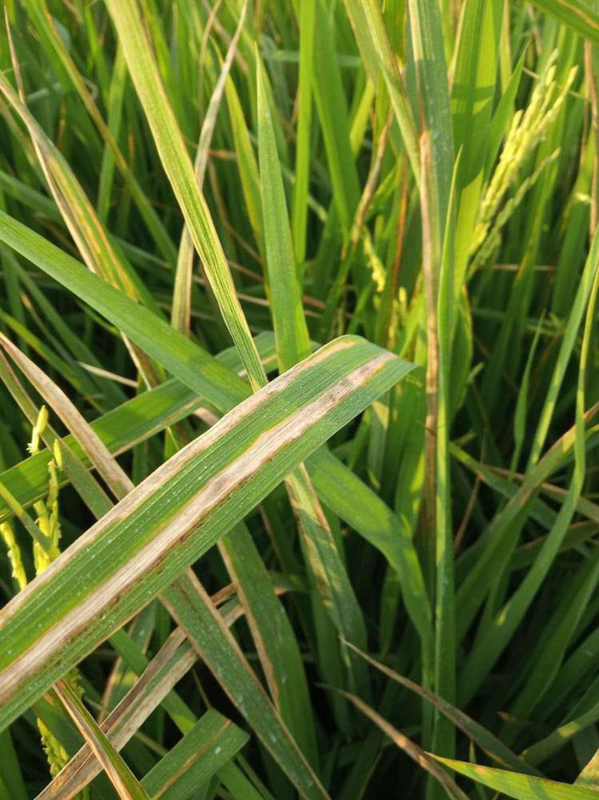
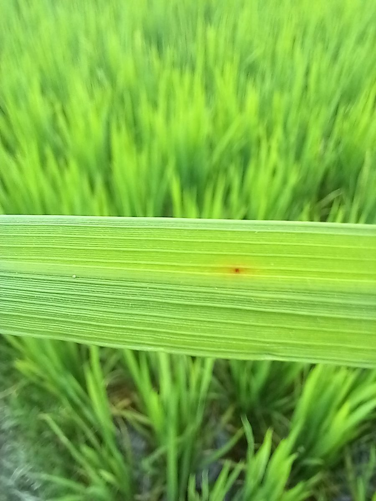
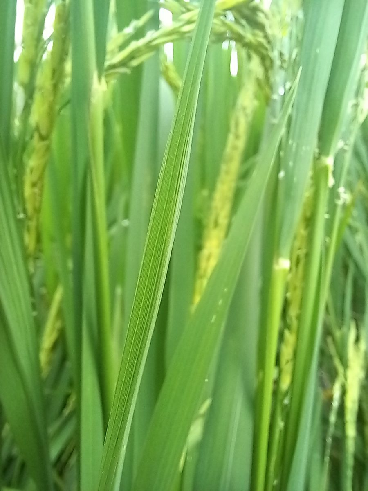
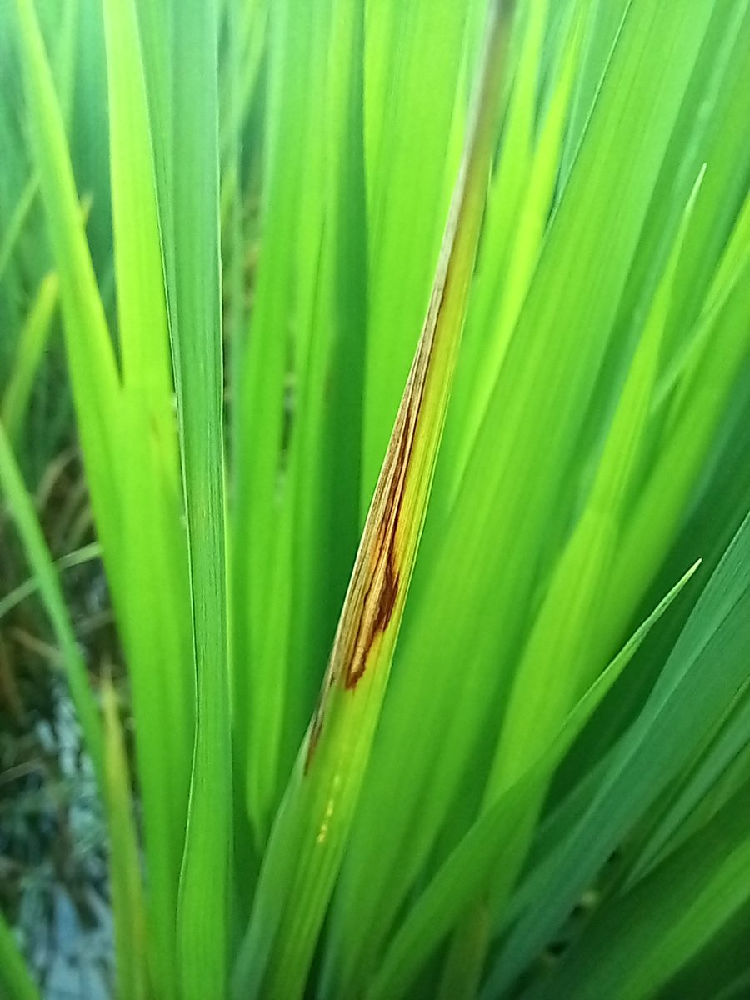
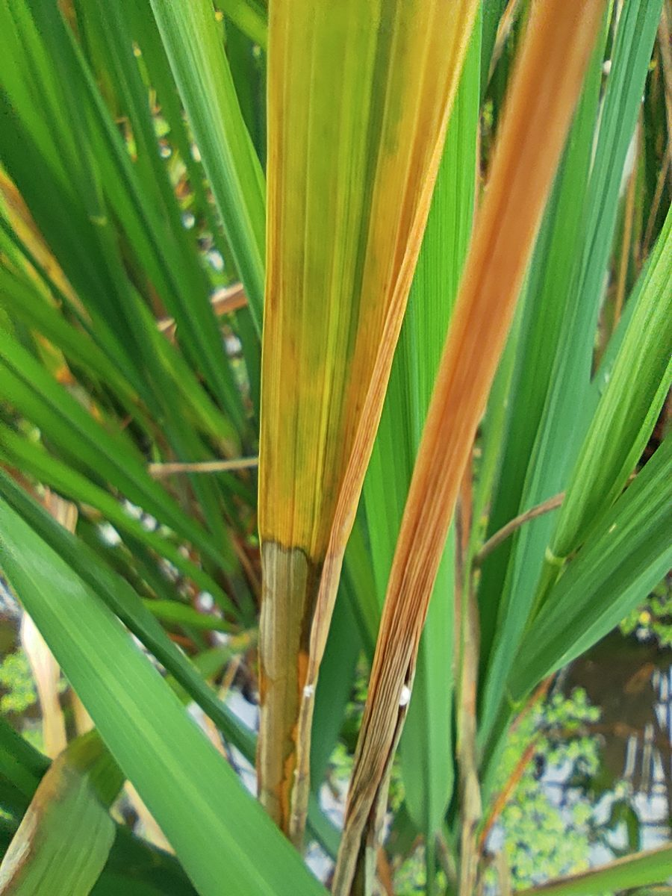
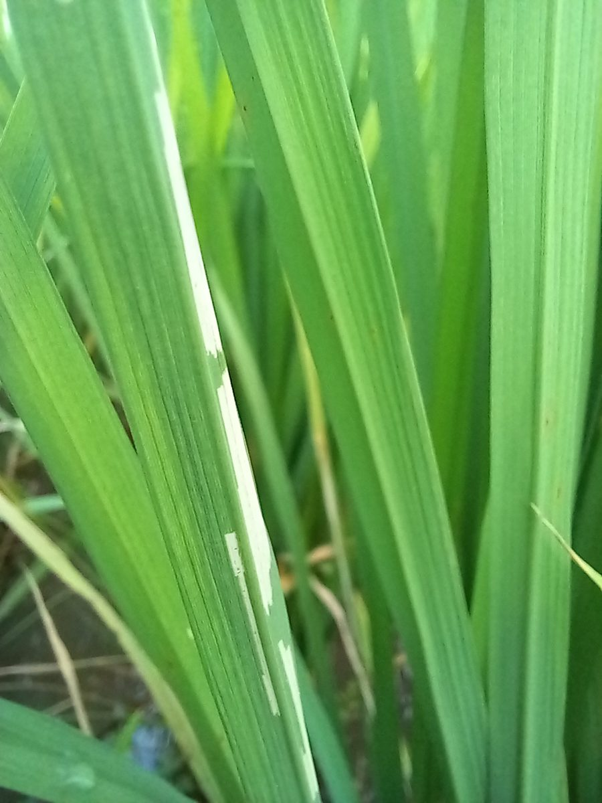

<div align="center">

<h1>PaddyLab</h1>

<p><b>AI-Powered Rice Leaf Condition Classification</b></p>

<p>
  A deep learning application that analyzes rice leaf images using a Convolutional Neural Network, identifying potential leaf conditions and presenting predicted classifications with confidence scores.
</p>

<p>
  My first AI model, developed as a final project for the Introduction to Artificial Intelligence course, exploring computer vision and image classification for agricultural applications.
</p>

<p>
  
  
  
  
  
  
  
</p>

<p>
  <a href="https://paddylab.vercel.app/"><b>Live Application</b></a>
  |
  <a href="https://github.com/johncarlonas/PaddyLab/blob/main/model-training.ipynb">Training Notebook</a>
</p>

</div>

---

## Overview

**PaddyLab** is my first artificial intelligence model, developed as a final project for the Introduction to Artificial Intelligence course.

The project explores how deep learning can be applied to agriculture by analyzing rice leaf photographs and identifying visual characteristics associated with different leaf conditions.

PaddyLab uses a **Convolutional Neural Network (CNN)** trained on labeled rice leaf images to classify an uploaded photograph into one of six supported categories.

The trained model is integrated into a Flask web application, allowing users to upload their own photographs, try sample images, and inspect model predictions with confidence scores.

The original training notebook records an overall **89.01% validation accuracy** across six rice leaf categories. This is an exploratory validation result rather than an independently established real-world accuracy figure.

The project demonstrates an end-to-end machine learning workflow, from dataset preparation and model training to evaluation and integration into a functional web application.

## Features

### Rice Leaf Classification

- **CNN-Based Classification** - Uses a trained Convolutional Neural Network to analyze rice leaf photographs.
- **Six-Class Recognition** - Predicts among six supported rice leaf conditions.
- **Confidence Scores** - Displays the model's confidence score for the predicted category.
- **Complete Class Breakdown** - Shows scores for all six supported categories.
- **Condition Descriptions** - Provides a short explanation of each predicted condition.
- **Uncertainty Indicator** - Displays a warning when the highest confidence score falls below 60%.

### Web Application

- **Image Upload** - Supports JPG, PNG, and WebP images.
- **Drag-and-Drop Interface** - Allows users to drag images directly into the analyzer.
- **Image Preview** - Displays the selected photograph before prediction.
- **Sample Images** - Includes six example photographs for testing the model.
- **Model Status** - Displays whether the trained model is available for inference.
- **Responsive Design** - Supports desktop and mobile interfaces.
- **Reset Functionality** - Allows users to remove an uploaded image and start another analysis.
- **About Page** - Explains the model, classifications, and project background.

## Supported Rice Leaf Conditions

PaddyLab classifies rice leaf photographs into six categories.

| Classification | Description |
| --- | --- |
| **Bacterial Leaf Blight** | A bacterial disease associated with water-soaked lesions, yellowing, and straw-colored leaf tissue. |
| **Brown Spot** | A fungal disease characterized by brown circular or oval spots on affected leaves. |
| **Healthy** | Rice leaves without visible symptoms of the supported diseases. |
| **Leaf Blast** | A fungal disease that may produce diamond-shaped or oval lesions with gray centers and darker margins. |
| **Leaf Scald** | A fungal disease associated with expanding brown lesions and damaged leaf tissue. |
| **Rice Hispa** | Damage associated with an insect pest that scrapes or feeds on rice leaf tissue. |

### Sample Images

The repository includes sample images representing each supported category.

<div align="center">

<table>
<tr>
<td align="center">
  
  <br />
  <b>Bacterial Leaf Blight</b>
</td>
<td align="center">
  
  <br />
  <b>Brown Spot</b>
</td>
<td align="center">
  
  <br />
  <b>Healthy</b>
</td>
</tr>
<tr>
<td align="center">
  
  <br />
  <b>Leaf Blast</b>
</td>
<td align="center">
  
  <br />
  <b>Leaf Scald</b>
</td>
<td align="center">
  
  <br />
  <b>Rice Hispa</b>
</td>
</tr>
</table>

</div>

These images are included in the repository and can also be used within the application.

## Technology Stack

| Technology | Purpose |
| --- | --- |
| Python | Machine learning development and backend application logic |
| TensorFlow | Deep learning model training and image preprocessing |
| Keras | CNN architecture, training, and model serialization |
| Flask | Web application and prediction API |
| NumPy | Numerical operations and model output processing |
| Pillow | Image validation, conversion, and orientation handling |
| Matplotlib | Training and validation visualizations |
| Scikit-learn | Classification metrics and evaluation reports |
| OpenCV | Image processing experiments in the training notebook |
| HTML5 | Web interface structure |
| CSS3 | Responsive styling and layout |
| JavaScript | Image uploads, API communication, and result visualization |
| Jupyter Notebook | Model development, training, and evaluation |

## Machine Learning Methodology

PaddyLab uses a supervised deep learning approach based on a Convolutional Neural Network.

The complete training and evaluation process is available in:

**[model-training.ipynb](./model-training.ipynb)**

### 1. Dataset Preparation

The original training notebook loaded a labeled rice leaf image dataset containing:

| Dataset Property | Value |
| --- | --- |
| Total Images Found | 9,289 |
| Number of Classes | 6 |
| Image Size | 256 x 256 pixels |
| Color Format | RGB |
| Loading Method | TensorFlow `image_dataset_from_directory` |
| Normalization | Pixel values divided by 255 |
| Intended Split | Approximately 80% training / 20% validation |

The dataset contains labeled images representing the six supported rice leaf conditions.

Images are resized during loading and normalized before being passed to the neural network.

The original training dataset is maintained separately and is not included in the public repository.

### 2. Model Architecture

The CNN uses three convolutional blocks followed by fully connected classification layers.

| Layer | Configuration |
| --- | --- |
| Input | 256 x 256 x 3 RGB image |
| Convolution 1 | 16 filters, 3 x 3, ReLU |
| Max Pooling 1 | 2 x 2 |
| Convolution 2 | 32 filters, 3 x 3, ReLU |
| Max Pooling 2 | 2 x 2 |
| Convolution 3 | 64 filters, 3 x 3, ReLU |
| Max Pooling 3 | 2 x 2 |
| Flatten | Converts feature maps into a vector |
| Dense | 128 units, ReLU |
| Dropout | 0.3 |
| Output | 6 units, Softmax |

The convolutional layers learn image features, while the dense layers use the extracted representations to classify the input image.

### Model Summary

| Property | Value |
| --- | --- |
| Architecture | Convolutional Neural Network |
| Total Parameters | **7,397,286** |
| Trainable Parameters | 7,397,286 |
| Non-Trainable Parameters | 0 |
| Output Classes | 6 |
| Output Activation | Softmax |

### 3. Training Configuration

The model was trained using the following configuration:

| Parameter | Value |
| --- | --- |
| Optimizer | Adam |
| Learning Rate | 0.001 |
| Loss Function | Sparse Categorical Crossentropy |
| Evaluation Metric | Accuracy |
| Maximum Epochs | 20 |
| Early Stopping | Enabled |
| Early Stopping Monitor | Validation Loss |
| Early Stopping Patience | 5 |
| Restore Best Weights | Enabled |

Early stopping was used to restore the best recorded model weights based on validation loss.

The saved notebook contains training output through epoch 17.

## Model Results and Evaluation

The following results were extracted from the original training notebook.

### Overall Performance

| Metric | Recorded Result |
| --- | ---: |
| **Validation Accuracy** | **89.01%** |
| **Validation Loss** | **0.3954** |
| Classification Report Accuracy | 89% |
| Macro Average Precision | 0.89 |
| Macro Average Recall | 0.89 |
| Macro Average F1-Score | 0.89 |
| Weighted Average Precision | 0.89 |
| Weighted Average Recall | 0.89 |
| Weighted Average F1-Score | 0.89 |
| Images Evaluated in Classification Report | 1,865 |

The validation accuracy of **89.01%** and validation loss of **0.3954** are taken from the notebook's printed model evaluation results.

### Class-Level Performance

The classification report provides precision, recall, and F1-score values for each rice leaf condition.

| Rice Leaf Condition | Precision | Recall | F1-Score | Support |
| --- | ---: | ---: | ---: | ---: |
| Bacterial Leaf Blight | 0.98 | 0.99 | 0.98 | 289 |
| Brown Spot | 0.82 | 0.87 | 0.84 | 291 |
| Healthy | 0.86 | 0.84 | 0.85 | 310 |
| Leaf Blast | 0.84 | 0.76 | 0.80 | 344 |
| Leaf Scald | 0.97 | 0.94 | 0.95 | 334 |
| Rice Hispa | 0.87 | 0.97 | 0.92 | 297 |
| **Macro Average** | **0.89** | **0.89** | **0.89** | **1,865** |
| **Weighted Average** | **0.89** | **0.89** | **0.89** | **1,865** |

These values are taken directly from the classification report generated in the training notebook.

### Performance Analysis

**Bacterial Leaf Blight**

The model achieved a precision of 0.98, recall of 0.99, and F1-score of 0.98, making it the strongest-performing class in the recorded classification report.

**Leaf Scald**

Leaf Scald achieved a precision of 0.97 and an F1-score of 0.95, indicating strong recognition performance within the evaluated validation images.

**Rice Hispa**

Rice Hispa achieved a recall of 0.97 and an F1-score of 0.92, showing that the model recognized most evaluated images belonging to this class.

**Brown Spot**

Brown Spot achieved an F1-score of 0.84. Its performance was lower than the strongest-performing categories, indicating that the model encountered greater difficulty distinguishing this condition.

**Healthy**

The Healthy category achieved a precision of 0.86, recall of 0.84, and F1-score of 0.85.

**Leaf Blast**

Leaf Blast had the lowest recorded F1-score at 0.80, with a recall of 0.76. This indicates that a comparatively larger portion of Leaf Blast examples were not correctly recognized in the evaluated set.

### Training and Validation Curves

The notebook includes plots showing:

- Training accuracy across epochs.
- Validation accuracy across epochs.
- Training loss across epochs.
- Validation loss across epochs.

These plots can be viewed directly in the saved training notebook:

**[View Training Curves and Evaluation Output](./model-training.ipynb)**

### Sample Prediction

The notebook also contains a prediction example using an image from the Healthy test-image directory.

The recorded output was:

```text id="4k4jhz"
Predicted Class: healthy
Confidence Score: 0.99
```

This demonstrates a successful prediction on that particular image.

A single successful example does not establish overall test-set performance.

### Evaluation Considerations

The original notebook created training and validation subsets using `take` and `skip` on a shuffled TensorFlow dataset.

Because the split was not established through a stable, independently held-out partition, the membership of the subsets could vary across iterations and introduce overlap.

Therefore, the reported evaluation results should be interpreted as **exploratory validation metrics**, not independently verified real-world performance.

A separate, fixed test dataset and a reproducible evaluation procedure are recommended for more reliable assessment of model generalization.

The notebook's per-class results are provided for transparency and to document the model's original experimental performance.

## Prediction Process

When a user uploads an image, PaddyLab performs a sequence of image preprocessing and inference operations.

### 1. Image Validation

The application checks whether the uploaded file uses a supported format and meets the configured upload restrictions.

### 2. Image Preprocessing

The uploaded image is converted to RGB, resized to 256 x 256 pixels, and normalized.

### 3. Model Inference

The processed image is passed into the saved CNN model.

The model generates six classification scores.

### 4. Prediction Ranking

The six scores are ranked from highest to lowest.

The class with the highest score becomes the primary prediction.

### 5. Result Display

The application displays:

- The predicted rice leaf condition.
- The highest confidence score.
- A description of the predicted category.
- Scores for all six classes.
- An uncertainty message when appropriate.

A model-generated confidence score does not represent a confirmed disease diagnosis.

## Project Structure

```text id="w92bax"
PaddyLab/
├── public/
│   └── static/
│       ├── samples/
│       │   ├── bacterial_leaf_blight.jpg
│       │   ├── brown_spot.jpg
│       │   ├── healthy.jpg
│       │   ├── leaf_blast.jpg
│       │   ├── leaf_scald.jpg
│       │   └── rice_hispa.jpg
│       ├── app.js
│       ├── leaf.svg
│       ├── lenis.css
│       ├── lenis.min.js
│       ├── lenis.LICENSE
│       ├── motion.js
│       └── style.css
├── templates/
│   ├── base.html
│   ├── classes.html
│   └── index.html
├── tests/
│   ├── browser.cjs
│   └── test_app.py
├── .gitignore
├── Rice Leaf Disease Detection v2.h5
├── app.py
├── model-training.ipynb
├── requirements.txt
└── README.md
```

### File Descriptions

| File / Directory | Description |
| --- | --- |
| `app.py` | Flask backend, model loading, preprocessing, and prediction API |
| `Rice Leaf Disease Detection v2.h5` | Saved trained six-class CNN model |
| `model-training.ipynb` | Original model training, experimentation, and evaluation notebook |
| `requirements.txt` | Python package dependencies |
| `templates/index.html` | Main rice leaf analysis interface |
| `templates/classes.html` | About page and six-class reference |
| `templates/base.html` | Shared page layout |
| `public/static/app.js` | Image upload handling and prediction result rendering |
| `public/static/style.css` | Application styling |
| `public/static/samples/` | Sample images for the six classes |
| `tests/test_app.py` | Backend and inference tests |
| `tests/browser.cjs` | Browser-based interaction tests |

The original full training dataset is not included in the public repository.

## Getting Started

Follow the steps below to run PaddyLab locally.

### Prerequisites

Install:

- [Python 3.12](https://www.python.org/downloads/)
- [Git](https://git-scm.com/downloads)
- A modern web browser

The application uses TensorFlow to load and execute the saved CNN model.

### 1. Clone the Repository

```bash id="tl6nks"
git clone https://github.com/johncarlonas/PaddyLab.git
```

Navigate into the project:

```bash id="0n6xg4"
cd PaddyLab
```

### 2. Create a Virtual Environment

**Windows (PowerShell)**

```powershell id="2de9lb"
py -3.12 -m venv .venv
.\.venv\Scripts\Activate.ps1
```

**macOS / Linux**

```bash id="yb6nu0"
python3 -m venv .venv
source .venv/bin/activate
```

### 3. Install Dependencies

```bash id="aypwpx"
python -m pip install --upgrade pip
python -m pip install -r requirements.txt
```

The application dependencies are:

```text id="d3tg18"
Flask>=3.0,<4
Pillow>=10.3,<13
tensorflow==2.16.2
```

### 4. Start the Application

```bash id="v2dkvb"
python app.py
```

Open the application in your browser:

```text id="4rxl6q"
http://127.0.0.1:5000
```

The application loads the saved CNN model when model status or prediction processing first requires it.

Initial model loading may take several seconds depending on the system's available resources.

## How to Use

### Analyze a Rice Leaf

1. Open PaddyLab.
2. Click **Choose a Photo** or drag an image into the upload area.
3. Select a clear rice leaf photograph.
4. Review the image preview.
5. Click **Analyze Photo**.
6. Wait for the model to process the image.
7. Review the predicted condition and confidence score.
8. Expand **All class scores** to inspect the remaining predictions.

### Try a Sample

1. Click **Try a sample**.
2. Allow the application to load an example image.
3. Click **Analyze Photo**.
4. Review the prediction and class confidence scores.

### Supported Uploads

| Requirement | Value |
| --- | --- |
| Accepted Formats | JPG, PNG, WebP |
| Maximum Upload Size | 10 MB |
| Maximum Image Resolution | 20 megapixels |
| Model Input Resolution | 256 x 256 pixels |
| Color Format | RGB |
| Classification Categories | 6 |

Uploaded images are processed in memory and are not saved to disk by the application.

## API Endpoints

PaddyLab includes endpoints for model status, prediction, and sample image retrieval.

### Model Status

```http id="wlw4p8"
GET /api/status
```

Returns the model's readiness status and supported classes.

### Predict Rice Leaf Condition

```http id="62rwn2"
POST /api/predict
```

Accepts an image as a multipart form submission under the `image` field.

Example:

```bash id="mfh4ma"
curl -X POST http://127.0.0.1:5000/api/predict \
  -F "image=@leaf.jpg"
```

The endpoint returns a JSON response containing:

- The primary prediction.
- Classification scores for all six classes.
- Confidence values.
- Class descriptions.
- The model identifier.

### Sample Image Retrieval

```http id="8p46ow"
GET /api/samples/<category>
```

Returns a sample image for the selected supported category.

### Application Pages

| Route | Purpose |
| --- | --- |
| `/` | Main rice leaf analyzer |
| `/about` | Project information and classification guide |
| `/classes` | Redirects to the About page |

## Model Training and Reproducibility

The model training notebook is available in the repository:

**[model-training.ipynb](./model-training.ipynb)**

It documents:

- Dataset loading and preprocessing.
- Training and validation preparation.
- CNN architecture creation.
- Model compilation.
- Model training with early stopping.
- Validation evaluation.
- Classification report generation.
- Training and validation curve visualization.
- Model serialization.
- Sample image prediction.

To open the notebook locally, install Jupyter and its dependencies:

```bash id="5uwtz1"
python -m pip install jupyterlab matplotlib scikit-learn opencv-python
```

Launch JupyterLab:

```bash id="fyxjiv"
python -m jupyter lab
```

Open `model-training.ipynb`.

**Note:** Reproducing the original training process requires the corresponding labeled dataset under the directory structure used in the notebook, including `dataset/train`.

The repository provides the trained model and saved notebook results but does not distribute the full original training dataset.

## Testing

The repository includes automated tests for backend behavior and browser functionality.

### Backend Tests

Run:

```bash id="7meq82"
python -m unittest discover -s tests
```

The tests cover:

- Page and route availability.
- Sample image retrieval.
- Upload validation.
- File type restrictions.
- Upload size restrictions.
- Model loading.
- Real inference using a sample photograph.
- Classification score structure.

### Browser Tests

The repository also includes:

`tests/browser.cjs`

This script uses Playwright and Microsoft Edge to evaluate interface behavior.

With the application running and the required browser testing tools installed, execute:

```bash id="2fd7u6"
node tests/browser.cjs
```

The browser tests cover image selection, prediction results, confidence score rendering, reset functionality, responsive layouts, and About page navigation.

## Project Limitations

PaddyLab is an educational image classification project intended to demonstrate the application of deep learning in agricultural image analysis.

The model is limited to six supported rice leaf conditions.

Its predictions may be affected by:

- Image quality and resolution.
- Lighting conditions.
- Background objects.
- Camera angle.
- Leaf visibility.
- Similar visual characteristics between conditions.
- Differences between training data and real-world photographs.

The model may also classify unrelated images into one of its six categories because it does not contain an explicit unknown-class detector.

The reported evaluation metrics come from the original experimental validation process and should not be treated as independently verified deployment performance.

The application is intended to support learning and further inspection rather than provide a definitive plant disease diagnosis.

## Future Improvements

Potential improvements include:

- Expanded datasets covering more rice diseases and pests.
- Improved representation of underperforming classes.
- Independent evaluation on an untouched test set.
- Reproducible dataset partitioning.
- Data augmentation and generalization improvements.
- Comparison with pretrained CNN architectures.
- Confidence calibration.
- Unknown-class and out-of-distribution detection.
- Model explainability and attention visualization.
- Mobile-friendly inference optimization.
- Additional experiments involving different image conditions.

## Project Background

PaddyLab is my first artificial intelligence model, developed as a final project for the Introduction to Artificial Intelligence course.

The project was created to explore how supervised deep learning and computer vision can recognize visual patterns in agricultural images.

Rather than focusing solely on model training, I also wanted to understand how a trained AI model could be integrated into an accessible application that allows users to interact with its predictions.

Through this project, I gained hands-on experience with:

- Image dataset preparation.
- Supervised deep learning.
- Convolutional Neural Networks.
- TensorFlow and Keras.
- Model training and evaluation.
- Classification metrics and performance analysis.
- Image preprocessing.
- Model serialization and inference.
- Flask API development.
- Integrating AI into a web application.

PaddyLab serves as a foundation for my continued exploration of artificial intelligence, computer vision, and practical machine learning applications.

---

<div align="center">

**PaddyLab - AI-Powered Rice Leaf Condition Classification**

My first AI model, developed for the Introduction to Artificial Intelligence course.

</div>
